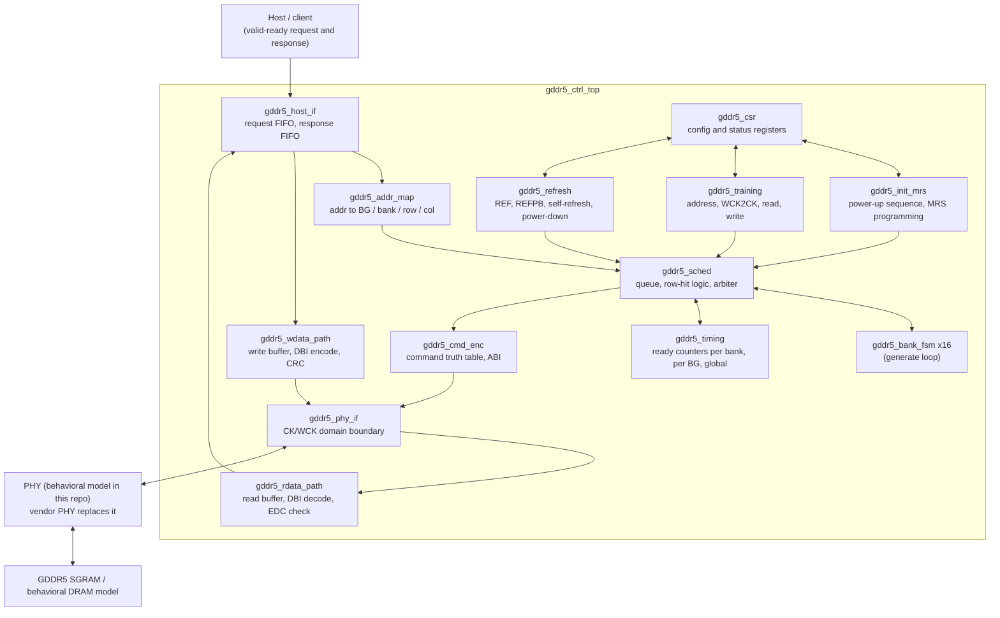
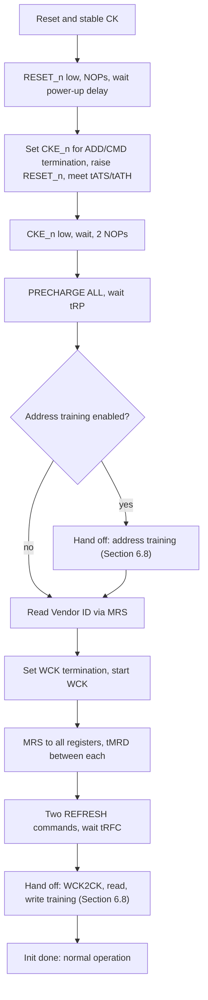
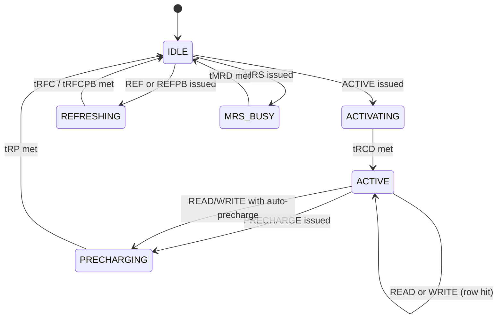

# GDDR5 Memory Controller — Microarchitecture Specification

| Field | Value |
|---|---|
| Document | `docs/microarchitecture.md` |
| Revision | 0.2 (draft for review) |
| Reference standard | JEDEC JESD212C.01, *GDDR5 SGRAM* (obtain from jedec.org; not redistributed in this repository) |
| Target device class | GDDR5 SGRAM, x32 mode, 8 Gb default (parameterized) |
| RTL language | Verilog-2005 (IEEE 1364-2005) |
| Status | Sections 1–9 are drafted from the standard. Open items are listed in Section 14. |

> **Reference convention.** A bare `§` number (for example §7.19) or "Table N" refers to JESD212C.01. References to this document are written "Section N".
>
> **Provenance.** This project is developed by the repository owner with AI assistance. The text below is written in our own words and cites JEDEC sections by number. It is not a copy of the standard. Where the standard gives numeric timing values, this document names the parameter and its section only; values come from the vendor datasheet speed bin and enter the design as parameters.

---

## 1. Scope and goals

### 1.1 What this document is
JESD212C.01 defines the **DRAM device**: its pins, commands, mode registers, timing rules and training procedures. It does not define a controller. This document specifies a controller that drives such a device and never violates a device rule. Every module below is tied to the JEDEC sections that constrain it (traceability matrix in Section 13).

### 1.2 Goals
- G1. Issue only legal command sequences for the device state tables (JEDEC §7.19, Tables 32–35).
- G2. Perform the power-up and initialization flow (§3.1, §3.2) and program all mode registers the controller uses (§6).
- G3. Enforce the AC timing parameters of §8.2 (Table 54), including the bank-group variants (§4.3, Table 9).
- G4. Provide refresh (all-bank and per-bank), self-refresh and power-down management (§7.15, §7.16, §7.18).
- G5. Implement DBI, ABI and EDC/CRC handling on the controller side (§4.2, §7.11, §7.12).
- G6. Implement the controller side of the interface training protocol (§5).
- G7. Be parameterized for density, bank count and speed grade; all timing values are parameters.

### 1.3 Non-goals
- Analog and electrical behavior: POD I/O levels, ODT, VREF generation, drive-strength calibration (§8.4–8.6, §9.3). These belong to the PHY and board.
- Package, ball-out and boundary scan (§9, §10).
- x16 clamshell mode and mirror function (MF) in the first release (§9.5). The design keeps hooks for them.
- Vendor-specific features (MR9, MR10, MR12–MR14 are vendor-defined, §6).

---

## 2. Device facts the design depends on

These facts are taken from JESD212C.01 and drive the architecture. Section numbers are given for each.

| # | Fact | Section |
|---|---|---|
| F1 | 8n prefetch. One read or write burst is 8 data words per pin: 256 bits on a x32 device, delivered over two CK cycles at the core. Burst length is fixed at 8, with no truncation or interruption of write bursts. | §2.2, §7.7 |
| F2 | CK_t/CK_c is the command/address clock. **Commands** are registered on every rising edge of CK_t (single data rate). **Addresses** are registered on rising CK_t and again on rising CK_c (double data rate). | §2.2, §2.4, §4.1 |
| F3 | Data is carried on free-running forwarded clocks WCK_t/WCK_c, which run at twice the CK frequency. Data is registered at both edges. | §2.4 |
| F4 | 16 banks for 1 Gb to 8 Gb devices (8 banks for 512 Mb), organized into **four bank groups**. Bank-group behavior is enabled through MR3 bits A10/A11 and matters above a frequency threshold (fCKBG). | §4.3, Table 8 |
| F5 | Commands are decoded from CS_n, RAS_n, CAS_n and WE_n (Table 33, §7.19). Auto-precharge is selected with address pin A8 on READ/WRITE. | §7.19, §7.7 |
| F6 | Mode registers MR0–MR8, MR11 and MR15 are defined. They have no reset defaults except ABI, ADD/CMD termination and the EDC hold pattern. All must be programmed at init. | §3.1, §6 |
| F7 | MRS requires all banks idle and no bursts in progress, and the controller must then wait tMRD. | §6 |
| F8 | REFRESH needs all banks precharged. Up to eight refreshes may be posted. The maximum gap between two consecutive REFRESH commands is 9 × tREFI. | §7.15 |
| F9 | Interface training must run in a fixed order: address (optional), WCK2CK, read, write. | §5.1, Figure 10 |

---

## 3. Top-level architecture

### 3.1 Block diagram

### 3.2 Hierarchy and instantiation

One top module instantiates the sub-modules. Replicated structures use `generate` loops (Verilog-2005).

| Instance | Count | Notes |
|---|---|---|
| `gddr5_bank_fsm` | `NUM_BANKS` (16) | `generate` loop; one per bank |
| `gddr5_timing` | 1 | Contains per-bank, per-bank-group and global counter arrays |
| `gddr5_sched` | 1 | Single command-issue point (one command per CK) |
| `gddr5_refresh`, `gddr5_init_mrs`, `gddr5_training`, `gddr5_cmd_enc`, `gddr5_csr`, `gddr5_host_if`, `gddr5_addr_map` | 1 each | |
| `gddr5_wdata_path` / `gddr5_rdata_path` | 1 each | Internally replicate byte-lane logic with `generate` (4 byte lanes on x32) |
| `gddr5_phy_if` | 1 | Behavioral PHY model sits outside the top |

### 3.3 Design principles
1. **Single issue point.** Only `gddr5_sched` may place a command on the command bus. Other modules (init, refresh, training) *request* command slots. This makes legality checking one place.
2. **Timing is table-driven.** Each JEDEC parameter in §8.2 maps to a counter. A command is legal only when every counter it depends on is zero.
3. **State mirrors the standard.** Bank FSM states correspond to the state definitions under Table 33 (Idle, Row Activating, Row Active, Read, Write, Precharging, Refreshing, and so on).
4. **No analog assumptions in RTL.** Delay adjustment is delegated to the PHY through a defined training interface.

---

## 4. Clocking, reset and parameters

### 4.1 Clocks
| Clock | Frequency | Used by |
|---|---|---|
| `ck` | fCK. Core clock of the controller. | All controller logic |
| `wck` | 2 × fCK (forwarded to the device) | PHY only (F3) |
| `host_clk` | Same as `ck` in release 1 | Host interface. An async FIFO is added later if the host runs on another clock. |

The controller core is clocked by `ck`. The CK-to-WCK relationship, alignment and serialization are PHY responsibilities. The controller only controls them through the training and CSR interfaces.

### 4.2 Reset
A synchronous, active-low `rst_n` resets the controller state. The device pin `RESET_n` is driven by `gddr5_init_mrs` as part of the power-up sequence (§3.1), not directly from `rst_n`.

### 4.3 Parameters (in `rtl/gddr5_params.vh`)

| Parameter | Default | Meaning |
|---|---|---|
| `DENSITY_GB` | 8 | Selects row/column widths (§4.1, Table 7) |
| `X16_MODE` | 0 | Reserved for clamshell support (§9.5) |
| `NUM_BANKS` | 16 | 8 for 512 Mb |
| `BG_ENABLE` | 1 | Mirrors MR3 A10/A11 (§4.3) |
| `TCK_PS` | per speed bin | Clock period in picoseconds |
| `T<name>_PS` / `T<name>_CK` | per speed bin | One parameter per §8.2 timing; ns values are converted to cycles by a constant function with ceiling rounding |
| `CLMRS`, `WLMRS`, `CRCRL`, `CRCWL` | per speed bin | Latencies programmed in MR0 and MR4 (§6) |
| `REQ_Q_DEPTH` | 16 | Scheduler request queue entries |
| `ADDR_MAP_MODE` | 0 | Selects address interleaving scheme (Section 6.2) |

Timing values are never hard-coded in RTL. The conversion rule is: `cycles = ceil(T_ps / TCK_PS)`, with the cycle-based parameters (given in tCK in §8.2) used directly.

---

## 5. Interfaces

### 5.1 Host interface (`gddr5_host_if`)
Simple valid/ready protocol. An AXI4 wrapper can be added later without changing the core.

| Signal | Dir | Width | Description |
|---|---|---|---|
| `req_valid` / `req_ready` | in / out | 1 | Handshake |
| `req_write` | in | 1 | 1 = write, 0 = read |
| `req_addr` | in | `ADDR_W` | Byte address, burst-aligned (32 bytes per burst on x32) |
| `req_id` | in | `ID_W` | Returned with read data |
| `req_wdata` | in | 256 | One full burst (8 beats × 32 bits) |
| `req_wmask` | in | 32 | Byte-enable (used when write masking is enabled, phase 3) |
| `rsp_valid` / `rsp_ready` | out / in | 1 | Read response handshake |
| `rsp_id` | out | `ID_W` | Matching request id |
| `rsp_rdata` | out | 256 | One full burst |
| `rsp_err` | out | 1 | EDC/CRC mismatch on this burst |

Ordering rule: requests to the **same address** complete in order. Different addresses may be reordered by the scheduler.

### 5.2 PHY-side interface (`gddr5_phy_if`)
All signals are in the `ck` domain at the controller edge. The PHY serializes to the pins.

| Signal group | Description |
|---|---|
| `cmd_cs_n, cmd_ras_n, cmd_cas_n, cmd_we_n` | Command pins (F5) |
| `cke_n`, `reset_n` | Clock-enable and device reset |
| `addr_first[13:0]`, `addr_second[13:0]` | The two halves of the DDR address, in the pin order defined in Section 6.7 |
| `abi_n_first`, `abi_n_second` | ABI_n for each address half (§4.2) |
| `wdata[255:0]`, `wdbi_n[3:0]` | Write burst and one DBI bit per byte lane (4 lanes on x32), presented for the WL window |
| `rdata[255:0]`, `rdbi_n[3:0]`, `edc[3:0]` | Read burst, DBI bits, and one EDC check value per byte lane, returned by the PHY |
| `wck_en`, `wck_phase_*` | WCK control and training adjust (§5.3) |
| `trn_*` | Training control/status: delay step, direction, sample results |

### 5.3 CSR interface
A simple register bus for software or a testbench to set modes and read status.

| Register | Purpose |
|---|---|
| `CTRL` | Enable, soft reset, start init, start training, enter/exit self-refresh and power-down |
| `MR_SHADOW[0..15]` | Shadow copy of the mode register values the controller programs |
| `TIMING_OVERRIDE` | Optional run-time timing override (for bring-up only) |
| `STATUS` | Init done, training done per stage, refresh debt, error flags |
| `ERR_CNT` | Counts EDC mismatches |

---

## 6. Module specifications

### 6.1 `gddr5_init_mrs` — power-up and mode-register programming
**Spec basis:** §3.1 (power-up), §3.2 (initialization with stable power), §3.3 (Vendor ID), §6.

Responsibilities:
- Sequence the device pins through the power-up steps the controller owns: stable clock, RESET_n low with NOPs, the 200 µs waits, setting CKE_n for the ADD/CMD termination setting and releasing RESET_n so the device latches its mode, then NOPs and PRECHARGE ALL.
- Program every mode register in the order the standard allows, honoring tMRD after each.
- Optionally run address training (hand-off to `gddr5_training`), read the Vendor ID, set WCK termination, start WCK, and issue the two initial REFRESH commands.

Rules from the standard that this module enforces:
- The PLL/DLL usage and the WCK/CK phase-detector position must be programmed before WCK2CK training; WLmrs, CLmrs, CRCWL and CRCRL must be programmed before it too (§3.1 step 18).
- Because MRs have no defaults, **all** MRs the design relies on are written explicitly (F6).
- Exact wait times (power-up delay, tATS, tATH, the optional extra wait before the first REFRESH) are parameters; vendor datasheets decide (§3.1).

Mode register content the controller sets (field-level detail is in §6 of the standard):

| MR | Contents the controller sets |
|---|---|
| MR0 | WR (write recovery), CAS latency (CLmrs), write latency (WLmrs) |
| MR1 | PLL reset, ABI enable, WDBI/RDBI, PLL/DLL, termination, driver strength |
| MR2 | Termination and OCD offsets |
| MR3 | Bank groups (A10/A11), WCK termination, RDQS mode, WCK2CK, self-refresh options |
| MR4 | EDC hold pattern, CRC read/write enable, CRC latencies (CRCRL, CRCWL) |
| MR5 | RAS field for auto-precharge, PLL bandwidth, low-power bits |
| MR6 | VREFD options, WCK pin option |
| MR7 | DCC, VDD range, temperature sense, PLL/DLL options |
| MR8 | Per-bank refresh enable, EDC Hi-Z, WR/CL extension bits |
| MR11 | PASR masks (row segment and 2-bank) |
| MR15 | Address-training mode and mirror/x16 related bits |

### 6.2 `gddr5_addr_map` — address mapping
**Spec basis:** §4.1 (Table 6, Table 7), §4.3 (Table 8).

The map converts a host byte address to `{bank_group, bank, row, column}`. The device-side address widths depend on density. For the default 8 Gb x32 device:

| Field | Width | Device pins |
|---|---|---|
| Row | 14 bits | A0–A13 |
| Column | 7 bits | A0–A6 |
| Bank | 4 bits | BA0–BA3 |
| Page size | 4 KB | |

Smaller densities use fewer row bits (Table 7); the map is parameterized by `DENSITY_GB`.

Bank-to-group assignment (16-bank devices): banks 0–3 belong to group A, 4–7 to B, 8–11 to C, 12–15 to D (Table 8). For 8-bank (512 Mb) devices the groups pair adjacent banks.

**Mapping policy (release 1).** Interleave consecutive bursts across bank groups first, then banks, then columns, so that back-to-back accesses use tCCDS, not tCCDL, whenever possible. `ADDR_MAP_MODE` selects alternatives, such as row-bank-column for locality.

### 6.3 `gddr5_bank_fsm` — per-bank state machine
**Spec basis:** Table 33 and its notes (§7.19), §7.5–7.6, §7.13–7.14.

One instance per bank. It tracks what the device believes the bank state to be, and which row is open (for row-hit decisions).

State rules taken from the standard (paraphrased):
- A bank is *Idle* once it is precharged and tRP has elapsed.
- *Row Active* means a row is open and tRCD has been satisfied.
- A bank must not be interrupted while Precharging, Row Activating, or doing auto-precharge until its timer expires.
- During Refreshing and Mode-register access, only NOP/DESELECT may be issued (Table 33 note 6).
- REFRESH and MRS need *all* banks idle. PER-BANK REFRESH needs only the target bank idle (note 8).
- Bank-level READ/WRITE (with or without auto-precharge) are legal only in Row Active (and in certain read/write follow-on states, notes 10–11).

Outputs to the scheduler: `state`, `open_row`, `row_valid`, `row_hit`, `can_act`, `can_rd`, `can_wr`, `can_pre`, `can_refpb`, `idle`, `cmd_err`.

**Implementation note (rev 0.3).** The timers that concern only one bank (tRCDRD, tRCDWR, tRAS, tRC, tRP, tRTP, write-to-precharge and tRFCPB) are down-counters inside `gddr5_bank_fsm`. `gddr5_timing` (Section 6.4) keeps only the timers that span banks. Auto-precharge is handled inside the bank: after a READ or WRITE with A8 high, the bank starts its own precharge as soon as PRE would be legal and accepts no further column command.

### 6.4 `gddr5_timing` — timing tracker
**Spec basis:** §8.2 (Table 54), §4.3 (Table 9), Table 35.

All spec timings are enforced with saturating **down-counters** that are loaded when the triggering command issues and count to zero. A command is legal when all counters it depends on are zero. Counters are grouped by scope:

| Scope | Parameters enforced | Notes |
|---|---|---|
| Per bank | tRC, tRAS, tRCDRD, tRCDWR, tRP, tWR, tRTPL / tRTPS, tDAL | tRTP applies only to a READ followed by PRECHARGE of the *same* bank (Table 9 note 1) |
| Per bank group (same group) | tRRDL, tCCDL, tWTRL | Used when `BG_ENABLE`=1 and the target is in the same group |
| Cross bank group | tRRDS, tCCDS, tWTRS | Applies to different groups, and to all banks when bank groups are disabled |
| Global (device) | tFAW (four-activate window), t32AW (thirty-two-activate window), tRTW (read-to-write turnaround), tPPD (precharge to precharge) | tFAW uses a four-entry timestamp window. t32AW uses a counter array. tRTW is a system turnaround parameter. |
| Refresh | tRFC, tRFCPB, tREFI, tREFIPB | Interval counters owned by `gddr5_refresh` |
| Mode / power | tMRD, tXS, tXPN, tCKE, tCPDED, tCKSRE, tCKSRX, tRDSRE, tWRSRE, tPD | |
| Training | tRCDLTR, tRCDRTR, tRCDWTR, tREFTR, tLTLTR, tWTRTR, tWRWTR, tRDTLT, tWRTLT, ... | Used only by `gddr5_training` |

The bank-group rules (Table 9) select which parameter applies:

| Sequence | Same bank group (BG enabled) | Different group, or BG disabled |
|---|---|---|
| ACTIVE to ACTIVE | tRRDL | tRRDS |
| READ to READ, WRITE to WRITE | tCCDL | tCCDS |
| WRITE to READ (internal) | tWTRL | tWTRS |
| READ to PRECHARGE (same bank) | tRTPL | tRTPS (BG disabled) or 1 tCK (different group) |

The auto-precharge interactions in Table 35 (for example the minimum delay after a WRITE with auto-precharge before a following READ, which depends on WLmrs, burst length, and tWTR) are implemented as additional cross-bank counters.

### 6.5 `gddr5_sched` — scheduler and command arbiter
**Spec basis:** §7 as a whole; the scheduler's policy is a design choice.

Inputs: request queue entries (from `gddr5_host_if` through `gddr5_addr_map`), bank states, timing readiness, refresh/training/init command requests.

**Arbitration priority (highest first):**
1. Mode register and init commands (`gddr5_init_mrs`).
2. Training commands (`gddr5_training`).
3. Refresh when the refresh debt reaches its urgent threshold (see Section 6.6).
4. Power-down / self-refresh entry and exit.
5. Row-hit column commands (READ/WRITE to an already-open row).
6. ACTIVE for the oldest request whose bank is idle.
7. PRECHARGE for a bank whose open row conflicts with the oldest pending request, or that is idle-timed-out.
8. Opportunistic refresh when no requests are pending.

**Policy (release 1):** open-page, row-hit first, then oldest first. Reads and writes are batched to reduce bus turnaround (tRTW and tWTR penalties); the batch size is a CSR parameter. Same-address ordering is preserved. Anything more advanced (priority classes, QoS) is out of scope for release 1.

**One command per CK.** The scheduler chooses at most one command each cycle. Because of F2, every command is accompanied by its two-phase address, which `gddr5_cmd_enc` produces.

### 6.6 `gddr5_refresh` — refresh, self-refresh, power-down
**Spec basis:** §7.15, §7.16, §7.17 (PASR), §7.18, Table 32.

**Refresh**
- Maintains a **refresh debt counter** incremented every tREFI. The device allows up to eight postponed refreshes (F8), so the controller may defer when busy but must issue before debt reaches the limit. The maximum spacing between two REFRESH commands is 9 × tREFI.
- Before an all-bank REFRESH, it asks the scheduler to precharge all banks. After REFRESH, no command is issued until tRFC has elapsed. The standard also advises NOPs only during the tKO calibration window after a refresh.
- **Per-bank refresh** (REFPB) is used when enabled in MR8 and supported by the vendor. REF and REFPB are distinguished by address pin A8. The target bank must be idle, and the per-bank interval is tREFIPB.
- The standard allows training commands (WRTR, RDTR, LDFF) to run in parallel with refresh after tREFTR if MR5 bit A2 is 0; the controller exposes this to `gddr5_training` as an optional mode.

**Self-refresh** (§7.16)
- *Entry:* all banks precharged and tRP met, last read/write data (and CRC) complete (tRDSRE / tWRSRE). The entry command looks like a REFRESH with CKE_n driven high. After entry the controller sends NOPs for tCKSRE. Clocks may then be stopped or changed.
- *Exit:* restart and stabilize clocks for tCKSRX, bring CKE_n low, then wait tXS before any command. WCK2CK training is required upon exit. Returning to self-refresh needs one more REFRESH after tXS.

**Power-down** (Table 32)
- Entry and exit are driven by CKE_n. Entering with all banks idle gives precharge power-down; with open banks it gives active power-down. Exit is by CKE_n low with NOP/DESELECT, then tXPN.

**PASR** (§7.17): MR11 masks are programmed by `gddr5_init_mrs`; this module only needs to know they exist (a masked segment is not retained).

### 6.7 `gddr5_cmd_enc` — command and address encoder
**Spec basis:** Table 17 (§7.1, the command truth table), Table 6 (§4.1), §4.2. Implemented in `rtl/gddr5_cmd_enc.v`; internal command codes are in `rtl/gddr5_cmds.vh`.

The encoder accepts one internal command code per cycle plus `bank` and `addr`, and registers the pin values (one cycle of latency). With `cmd_valid` low it drives DESELECT. `CKE_n` is passed through, registered, so the power manager can align it with the command (SELF REFRESH ENTRY needs `CKE_n` high). An unsupported or undefined code drives DESELECT pins and sets `cmd_err`.

**Command pins and qualifier pins** (Table 17). H = high, L = low, V = any valid level (the RTL drives V pins high, which keeps the number of low address pins small):

| Command | CS_n | RAS_n | CAS_n | WE_n | A11 | A10 | A8 | Notes |
|---|---|---|---|---|---|---|---|---|
| DESELECT | H | V | V | V | V | V | V | |
| NOP | L | H | H | H | V | V | V | |
| MODE REGISTER SET | L | L | L | L | opcode | opcode | opcode | BA = register number, A0–A11 = opcode |
| ACTIVE | L | L | H | H | row | row | row | BA = bank, A0–A13 = row |
| READ / READ with AP | L | H | L | H | L | L | L / H | A8 high = auto-precharge; BA = bank; column on A0–A7 |
| WRITE without mask (WOM / WOMA) | L | H | L | L | L | L | L / H | |
| WRITE single-byte mask (WSM / WSMA) | L | H | L | L | L | H | L / H | |
| WRITE double-byte mask (WDM / WDMA) | L | H | L | L | H | L | L / H | |
| READ training (RDTR) | L | H | L | H | H | H | L | BA and other pins V |
| WRITE training (WRTR) | L | H | L | L | H | H | L | BA and other pins V |
| PRECHARGE (one bank) | L | L | H | L | V | V | L | BA = bank |
| PRECHARGE ALL | L | L | H | L | V | V | H | BA = V |
| PER-BANK REFRESH | L | L | L | H | V | V | L | BA = bank; needs MR8 enable |
| REFRESH | L | L | L | H | V | V | H | |
| SELF REFRESH ENTRY | L | L | L | H | V | V | V | `CKE_n` goes high in the same cycle |

READ and WRITE differ only in WE_n; LDFF, RDTR and WRTR are distinguished from READ/WRITE variants by A11/A10 (LDFF: A11 high, A10 low, with READ pins). Power-down entry and exit and self-refresh exit are `CKE_n` transitions with NOP or DESELECT (Table 17, Table 32). **Not yet encoded: LDFF** — Table 17 note 7 places its data on A0–A9 and BA3, which overlaps the fixed A8/A10 qualifier pins; this needs a closer reading (open item O1).

**Address phases** (Table 6). The first half is sampled with the command on rising CK_t; the second half on the next rising CK_c:

| Phase | Pins carried |
|---|---|
| Rising CK_t | BA3, BA2, BA1, BA0, A12 (if present), A11, A10, A9, A8 |
| Rising CK_c | A3, A4, A5, A2, A13 (if present), A6, A0, A1, A7 |

A12 exists for 2 Gb and above; A13 for 4 Gb and 8 Gb; they share one physical pin. The encoder builds the logical address bits for each command and splits them across the two phases using this fixed pin order. Two parameters describe the device: `HAS_A12A13` (the shared pin exists) and `ABI_MAX_LOW`.

**Address Bus Inversion** (§4.2). When ABI is enabled in MR1, the controller counts the zeros on the address pins of each phase. If the count exceeds the allowed maximum (4 pins low for 512 Mb and 1 Gb, 5 for larger densities; the pin that does not exist on small devices is not counted), it inverts the whole phase and drives ABI_n low. ABI_n is double data rate, so each address phase has its own ABI_n value; otherwise it sends the pattern as is with ABI_n high. The device undoes the inversion. ABI is an electrical-signaling feature, so it applies to every address phase, including mode register opcodes.

### 6.8 `gddr5_training` — interface training
**Spec basis:** §5.1–5.5 and Figure 10.

The standard fixes the order: **address → WCK2CK → read → write** (F9). Reasons given: address training makes the mode registers reliably writable; WCK2CK first because a WCK shift moves all read timing; read before write because good write training needs trustworthy read data.

| Stage | Purpose | Controller actions | Spec |
|---|---|---|---|
| Address training (optional) | Align address inputs | Enter via MR15, send patterns, read back address on DQ, adjust address delay in the PHY | §5.2 |
| WCK2CK training | Align WCK to CK | Stop WCK, MRS to enter training, restart WCK, sweep phase and read phase-detector result on EDC | §5.3 |
| Read training | Find data-eye center and burst frame per pin | `LDFF` to load the read FIFO, `RDTR` to read it, compare, sweep PHY delay per pin | §5.4 |
| Write training | Find data-eye center for writes | `WRTR` to write into the FIFO, `RDTR` to read it back, compare, sweep PHY delay | §5.5 |

Preconditions the controller checks before each stage (examples from the standard): at least one bank active, or a refresh in progress with MR5 A2 = 0, so the WCK tree runs; WCK2CK complete before read training; PLL/DLL locked if used; RDBI/WDBI enabled to include the DBI pins, RDCRC/WRCRC enabled to include the EDC pins.

Neither LDFF/RDTR nor WRTR/RDTR touch the memory array, which means training does not disturb stored data.

**Algorithm ownership.** The standard defines what the *device* does during training. The search procedure (step size, how to pick the center of a passing window, retry policy) is our design. It is documented in `docs/training_algorithm.md` (to be written) and kept separate so alternative algorithms can be swapped in.

**PHY coupling.** Training is meaningful only if the PHY exposes delay controls. The behavioral PHY in this repo models per-pin delay taps with a configurable "true eye center" so the algorithms can be tested.

### 6.9 `gddr5_wdata_path` — write data path
**Spec basis:** §7.7, §7.8, §7.10, §7.11, §7.12.

- Accepts one 256-bit burst from the host, buffers it until the scheduler issues the WRITE, and presents it to the PHY at write latency WLmrs after the command.
- **DBI** (§7.11): for each byte, if more than four of the eight DQ bits would be low, the byte is inverted and DBI_n is driven low; otherwise it is sent unchanged with DBI_n high. Limiting low bits to four per byte reduces power and noise. DBI is enabled by the WDBI bit in MR1.
- **CRC** (§7.12): the controller computes the same CRC the device computes over each byte lane's burst (CRC-8 using the ATM HEC polynomial x⁸ + x² + x + 1, seed zero, over the 8 DQ bits plus the DBI bit across 8 beats = 72 bits per lane) and compares it with the checksum returned on the EDC pin. A mismatch sets `rsp_err` or an error flag for the write. The device performs detection only, no correction, so retry is the controller's choice (retry policy is a CSR option).
- Write data **mask** variants (WOM, WSM, WDM, §7.7–7.8) are deferred to phase 3; the interface already carries `req_wmask`.

### 6.10 `gddr5_rdata_path` — read data path
**Spec basis:** §7.9–7.12, §7.21.

- Captures the 8-beat burst returned by the PHY CLmrs after the READ command, undoes DBI inversion per byte (inverted when DBI_n is low), and presents it to the host.
- Computes the expected CRC on the received data and compares it with the EDC value returned at CRCRL; a mismatch sets `rsp_err`.
- In RDQS mode (§7.21, MR3 bit A5), the strobe arrives on the EDC pins and the EDC checking is disabled; the capture clock source switches accordingly (PHY function; the controller only sets the mode).

### 6.11 `gddr5_csr` — configuration and status
Holds the registers in Section 5.3, the shadow copies of MR0–MR15, and counters (refreshes issued, activates, row hits, EDC errors). It is the only module that talks to software.

---

## 7. Key behaviors

### 7.1 Latency and the data window
A READ is followed by data after CLmrs cycles; a WRITE needs data after WLmrs cycles. With CRC enabled, the check bits come at CRCRL (read) and CRCWL (write) cycles. A burst occupies two CK cycles at the core (F1). The scheduler must keep the **data bus** free for these windows, which is why tCCD (burst spacing) and the read-write turnaround (tRTW, tWTR) are part of command legality.

### 7.2 Command legality rule (summary)
A command `C` to bank `b` in group `g` is **legal this cycle** if all of the following hold:
1. The bank state allows `C` (Table 33).
2. All per-bank counters relevant to `C` are zero.
3. The bank-group counters selected by Table 9 (same group vs. other) are zero.
4. Global counters (tFAW, t32AW, tRTW and so on) are zero.
5. No refresh/MRS/training/self-refresh sequence owns the bus.
6. The CKE_n state is correct for the command (Table 32).

### 7.3 Row-buffer policy
Open-page. A row stays open until a conflicting request arrives, a refresh is due, or an idle timeout fires. READ/WRITE use auto-precharge (A8 high) when the scheduler knows no further hit is queued for that row.

---

## 8. Power management and low-frequency modes
- Self-refresh and power-down: Section 6.6.
- Low-frequency operation (§7.20): the standard requires support for a contiguous range from 50 MHz up to the rated speed. Lower speeds allow PLL-off, RDQS mode, relaxed termination and, at the lowest range, no training. The controller exposes mode bits through the CSR and MR programming; the speed-dependent feature choice is a **configuration table**, not logic.
- Clock frequency change (§7.22), dynamic voltage switching (§7.23), temperature sensor (§7.24) and duty cycle corrector (§7.25): modeled as control and status hooks to the PHY. Phase 4.

---

## 9. Error handling
| Event | Detection | Response |
|---|---|---|
| EDC mismatch on read | `gddr5_rdata_path` | Set `rsp_err`, increment `ERR_CNT`, optional retry |
| EDC mismatch on write | `gddr5_wdata_path` | Same; retry re-issues the write burst |
| Refresh debt overflow | `gddr5_refresh` | Sticky error flag (should be unreachable by design; assertion) |
| Training failure | `gddr5_training` | Set stage-specific fail flag, stop, leave device out of normal operation |
| Illegal command attempted | Assertion in simulation | Fail the test; the scheduler must never issue one |

---

## 10. Verification plan (summary)

| Layer | Tool | Purpose |
|---|---|---|
| Directed testbench | Verilog-2005 + Icarus | Bring-up: init, MRS, single read/write, refresh |
| Unit and block tests | cocotb | Address map, timing counters, bank FSM, encoders, DBI/CRC against Python models |
| System-level random | pyuvm + `cocotb-coverage` | Constrained-random traffic, scoreboard against a reference memory model, functional coverage |
| Assertions | Immediate assertions (SymbiYosys) and simple concurrent assertions in Verilator | Timing rules in §8.2 and the legality rule in Section 7.2, each citing its JEDEC section |
| Formal | SymbiYosys | Bounded proofs on `gddr5_timing` and `gddr5_bank_fsm` |
| DRAM model | Behavioral Verilog-2005 model written for this repo | Checks every command against the standard's timing and state rules |

**Coverage goals:** all command types, all bank/bank-group pairs for ACT-ACT and column-column spacing, row-hit and row-miss, refresh posting up to the limit, self-refresh entry/exit, power-down, EDC error injection, each training stage pass and fail.

The DRAM model and all checks are written from the standard, not from any vendor model.

---

## 11. Synthesis and implementation intent
- **Open-source flow:** Yosys for synthesis, OpenSTA for timing, OpenLane 2 / OpenROAD on the SkyWater 130 nm PDK for place and route of selected blocks.
- A real GDDR5 controller targets multi-GHz data rates, which SkyWater 130 nm cannot reach. The flow is used to demonstrate a clean, synthesizable design and to produce area and cell-count reports, **not** production-speed timing. Reports are labeled accordingly.
- **Coding standard:** Verilog-2005 only; `wire`/`reg`, `localparam` state encodings, shared constants in `.vh` includes, ANSI-style ports, `generate` for replication. No SystemVerilog in `rtl/`. SystemVerilog is allowed only in `sva/` checker files.
- Lint: Verilator `--lint-only` and Verible in CI.

---

## 12. Phased implementation plan

| Phase | Content | Exit criterion |
|---|---|---|
| 1 | Address map, command encoder, bank FSM, timing tracker, init + MRS, ACT/READ/WRITE/PRECHARGE | Directed and cocotb tests pass against the DRAM model with no timing violations |
| 2 | Scheduler (row-hit, batching), refresh (all-bank, per-bank), host interface | Random traffic passes; refresh never overdue |
| 3 | DBI, ABI, EDC/CRC, write masks, self-refresh, power-down | Error injection tests pass; low-power sequences verified |
| 4 | Training (address, WCK2CK, read, write) against the PHY model, low-frequency modes | Each stage converges to the model's true eye center |
| 5 | Synthesis, STA, optional P&R, documentation polish | Reports archived; reproducible by `make` and Docker |

Each phase is developed on feature branches with small commits, an issue per feature, and a PR with CI results.

---

## 13. Traceability matrix (JESD212C.01 → design)

| JEDEC section | Topic | Module(s) |
|---|---|---|
| §2.2, §2.4 | 8n prefetch, CK/WCK clocking | `gddr5_phy_if`, §4.1 |
| §3.1, §3.2 | Power-up and init sequences | `gddr5_init_mrs` |
| §3.3 | Vendor ID | `gddr5_init_mrs` |
| §4.1, Tables 6–7 | Addressing, DDR address phases | `gddr5_addr_map`, `gddr5_cmd_enc` |
| §4.2 | Address bus inversion | `gddr5_cmd_enc` |
| §4.3, Tables 8–9 | Bank groups | `gddr5_addr_map`, `gddr5_timing` |
| §5.1–5.5 | Training | `gddr5_training` |
| §6 | Mode registers | `gddr5_init_mrs`, `gddr5_csr` |
| §7.4 | MRS | `gddr5_init_mrs`, `gddr5_cmd_enc` |
| §7.5, §7.6 | ACTIVE, bank restrictions | `gddr5_bank_fsm`, `gddr5_timing` |
| §7.7, §7.8 | WRITE, write masks | `gddr5_wdata_path` |
| §7.9, §7.10 | READ, DQ preamble | `gddr5_rdata_path` |
| §7.11 | DBI | `gddr5_wdata_path`, `gddr5_rdata_path` |
| §7.12 | EDC / CRC | `gddr5_wdata_path`, `gddr5_rdata_path` |
| §7.13, §7.14 | PRECHARGE, auto-precharge | `gddr5_bank_fsm`, `gddr5_sched` |
| §7.15 | Refresh, per-bank refresh | `gddr5_refresh` |
| §7.16, §7.17 | Self-refresh, PASR | `gddr5_refresh`, `gddr5_init_mrs` |
| §7.18 | Power-down | `gddr5_refresh` |
| §7.19, Tables 32–35 | Command truth tables | `gddr5_cmd_enc`, `gddr5_bank_fsm`, `gddr5_timing` |
| §7.20, §7.21 | Low-frequency modes, RDQS | `gddr5_csr`, `gddr5_rdata_path` |
| §7.22–7.25 | Frequency change, DVS, temperature sensor, DCC | PHY hooks (phase 4) |
| §8.2, Table 54 | AC timing parameters | `gddr5_timing` |

---

## 14. Open items and assumptions

These are deliberate gaps in revision 0.1, not hidden assumptions.

| # | Item | Plan |
|---|---|---|
| O1 | LDFF encoding: data-bit placement (Table 17 note 7) overlaps the fixed A8/A10 qualifier pins | Re-read §5.4 and the LDFF figure; encode when resolved. RDTR and WRTR are done (Section 6.7) |
| O2 | Write mask data handling (WOM/WSM/WDM command encodings are done) | Read §7.7–7.8 for how mask data accompanies the burst, then define `req_wmask` handling |
| O3 | READ timing and DQ preamble details (§7.9, §7.10) | Read and add data-window timing diagrams |
| O4 | Address training and WCK2CK protocol details (§5.2, §5.3) | Read in full; write `docs/training_algorithm.md` |
| O5 | Exact MR field definitions (§6.1–6.11) | Generate a field table from the standard when writing `gddr5_csr` |
| O6 | Timing values per speed bin | Not copied from the standard; supplied as parameters from a vendor datasheet |
| O7 | Power-down, frequency change, DVS and DCC details (§7.18, §7.22–7.25) | Read when those phases start |
| O8 | Scheduler tuning (batch size, idle timeout) | Decide empirically in phase 2 |
| O9 | Default speed grade | Pick the slowest rated grade first to make timing easy to close |

Decisions to confirm with the project owner: default density (8 Gb x32 assumed), host interface (valid/ready first, AXI later), open-page policy, and the speed grade for the first release.

---

## 15. Revision history

| Rev | Date | Change |
|---|---|---|
| 0.1 | 2026-11-18 | Initial draft from JESD212C.01 sections 2–8 (see Section 14 for what remains) |
| 0.2 | 2026-11-19 | Section 6.7 rewritten from Table 17 (full command encodings including write-mask variants, training commands, auto-precharge polarity); open items O1, O2 narrowed |
