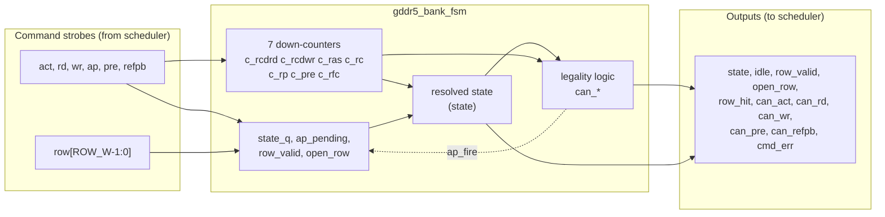
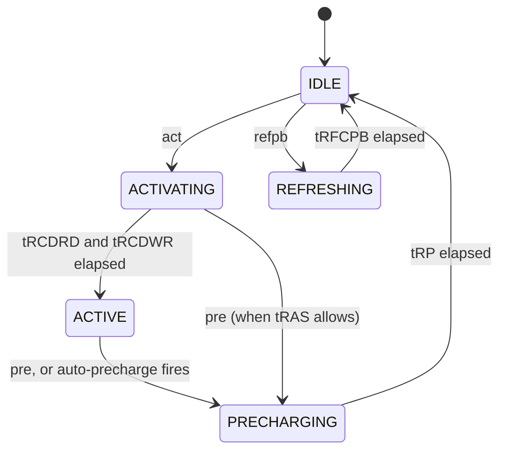

# `gddr5_bank_fsm` — Per-Bank State Machine and Timers

Microarchitecture specification for `rtl/gddr5_bank_fsm.v`.

| Field | Value |
|---|---|
| Module | `gddr5_bank_fsm` |
| Language | Verilog-2005 (`iverilog -g2005`, Verilator `--language 1364-2005`) |
| Clock domain | `clk` (the controller clock, CK) |
| Instances | One per bank (16 for an 8 Gb x32 device) |
| Latency | Outputs reflect a command in the cycle after it is issued |
| Reference standard | JEDEC JESD212C.01: Table 33 (§7.19), §7.5–7.6, §7.13–7.14, Table 9, Table 35 |
| Parent document | [`docs/microarchitecture.md`](../docs/microarchitecture.md), Section 6.3 |
| Status | Implemented and verified (see Section 10); all-bank REF and PREALL support is open (Section 8) |

> Spec text is paraphrased, not copied. Section numbers refer to JESD212C.01 unless written "Section N", which refers to this document.

---

## 1. Purpose

The scheduler must know, for every bank, whether a command may be issued in the current cycle. `gddr5_bank_fsm` answers that for one bank. It keeps the state the device believes the bank is in, which row is open, and the timers that depend only on this bank's own command history.

It does not issue commands, and it does not track spacing between different banks (tRRD, tCCD, tWTR, tFAW, t32AW). Those belong to `gddr5_timing`. A command is legal only when both this module and `gddr5_timing` allow it.

## 2. Block diagram



State diagram:



## 3. Parameters

All timings are minimum command-to-command spacings in clock cycles. The caller converts the vendor datasheet values with `ceil(T_ps / TCK_PS)`. The defaults below are illustrative placeholders, not vendor data: Table 54 of the standard leaves AC values to the device datasheet.

| Parameter | Default | Spacing it enforces |
|---|---|---|
| `ROW_W` | 14 | Row address width (14 for an 8 Gb x32 device) |
| `TRCDRD` | 12 | ACT to READ, same bank |
| `TRCDWR` | 8 | ACT to WRITE, same bank |
| `TRAS` | 28 | ACT to PRE, same bank (minimum row-open time) |
| `TRC` | 40 | ACT to ACT, same bank |
| `TRP` | 12 | PRE to ACT or REFPB, same bank |
| `TRTP` | 2 | READ to PRE, same bank |
| `TW2PRE` | 16 | WRITE to PRE, same bank. The caller supplies WL + burst time + tWR as one number. |
| `TRFCPB` | 60 | REFPB to ACT or REFPB, same bank |

Limits: every timing must be below 256 (the counters are 8 bits wide, `CW`). A value of 0 or 1 both mean "legal in the next cycle".

## 4. Interface

### 4.1 Inputs

| Signal | Width | Description |
|---|---|---|
| `clk` | 1 | Controller clock |
| `rst_n` | 1 | Synchronous active-low reset |
| `act` | 1 | ACTIVE command to this bank, one-cycle strobe |
| `rd` | 1 | READ to this bank |
| `wr` | 1 | WRITE to this bank |
| `ap` | 1 | With `rd` or `wr`: use auto-precharge (A8 high on the device) |
| `pre` | 1 | PRECHARGE to this bank |
| `refpb` | 1 | Per-bank refresh |
| `row` | `ROW_W` | Row to open for `act`. At all other times, the row the scheduler wants to test with `row_hit`. |

At most one of `act`, `rd`, `wr`, `pre`, `refpb` may be high in a cycle.

### 4.2 Outputs

| Signal | Width | Description |
|---|---|---|
| `state` | 3 | Resolved bank state (Section 5), exact in the current cycle |
| `open_row` | `ROW_W` | Row opened by the last ACT. Meaningful only while `row_valid` is high. |
| `row_valid` | 1 | A row is open and no precharge has begun |
| `row_hit` | 1 | `row_valid` and `row == open_row` (combinational from `row`) |
| `can_act` | 1 | ACT is legal this cycle |
| `can_rd` | 1 | READ is legal this cycle |
| `can_wr` | 1 | WRITE is legal this cycle |
| `can_pre` | 1 | PRE is legal this cycle |
| `can_refpb` | 1 | REFPB is legal this cycle (same condition as `can_act`) |
| `idle` | 1 | Bank is precharged and tRP or tRFCPB has elapsed |
| `cmd_err` | 1 | Registered. High for one cycle after a strobe was asserted while its `can_*` was low. |

### 4.3 Timing

| Cycle | Event |
|---|---|
| N | Scheduler sees `can_act = 1` and asserts `act` |
| N+1 | `state = ACTIVATING`, `row_valid = 1`, `open_row` holds the row, `can_act = 0` |
| N + tRCDWR | `can_wr` rises |
| N + tRCDRD | `can_rd` rises and `state = ACTIVE` (when tRCDRD is at least tRCDWR; otherwise `ACTIVE` follows the later of the two) |

All `can_*` outputs are combinational from registers, so they are stable early in the cycle and can feed the scheduler's selection logic.

## 5. State encoding

| Code | Name | Meaning |
|---|---|---|
| 0 | `S_IDLE` | Precharged and timers expired |
| 1 | `S_ACTIVATING` | Row opened, tRCD not yet met for both READ and WRITE |
| 2 | `S_ACTIVE` | Row open and both tRCD values met |
| 3 | `S_PRECHARGE` | PRE or auto-precharge issued, tRP running |
| 4 | `S_REFRESH` | REFPB issued, tRFCPB running |

The registered state `state_q` can lag a timer expiry by one cycle. The `state` output is resolved combinationally (for example `S_PRECHARGE` with `c_rp == 0` reads as `S_IDLE`), so `state` and every `can_*` are exact in the cycle they take effect.

## 6. Functional description

### 6.1 Timer convention

Seven down-counters hold the remaining wait for each spacing. A command in cycle `t` that imposes a spacing of `N` loads `N - 1`, so the counter reads 0 in cycle `t + N` and the dependent command is legal in that cycle. Counters stop at 0.

| Counter | Loaded by | With | Gates |
|---|---|---|---|
| `c_rcdrd` | ACT | TRCDRD | `can_rd`, ACTIVATING to ACTIVE |
| `c_rcdwr` | ACT | TRCDWR | `can_wr`, ACTIVATING to ACTIVE |
| `c_ras` | ACT | TRAS | `can_pre` |
| `c_rc` | ACT | TRC | `can_act` |
| `c_pre` | RD, WR | TRTP or TW2PRE (the larger remaining value wins) | `can_pre` |
| `c_rp` | PRE, auto-precharge | TRP | return to IDLE |
| `c_rfc` | REFPB | TRFCPB | return to IDLE |

`c_pre` is cleared by ACT. Because `can_pre` also needs `c_ras == 0`, a PRE waits for the latest of tRAS, tRTP after the last READ, and the write-to-precharge delay after the last WRITE.

### 6.2 Legality

```
is_open   = state is ACTIVATING or ACTIVE
can_act   = idle and c_rc == 0
can_refpb = can_act
can_rd    = is_open and c_rcdrd == 0 and not ap_pending
can_wr    = is_open and c_rcdwr == 0 and not ap_pending
pre_ready = is_open and c_ras == 0 and c_pre == 0
can_pre   = pre_ready and not ap_pending
```

`idle` already implies that tRP (after PRE) and tRFCPB (after REFPB) have elapsed, so `can_act` does not test `c_rp` or `c_rfc` again. Once an auto-precharge is pending, no further READ, WRITE or explicit PRECHARGE is accepted for the bank: the pending auto-precharge owns the precharge. (`pre_ready` only says that the timing allows a precharge.)

### 6.3 Behavior (event-driven)

```
every cycle:
    each counter c_x with c_x != 0: c_x <= c_x - 1
    state_q <= state                      (resolved state carried forward)
    cmd_err <= (act   and not can_act)
            or (rd    and not can_rd)
            or (wr    and not can_wr)
            or (pre   and not can_pre)
            or (refpb and not can_refpb)

on ap_fire (ap_pending and pre_ready):
    state_q <= S_PRECHARGE
    row_valid <= 0
    ap_pending <= 0
    c_rp <= TRP - 1

on act with can_act:
    state_q <= S_ACTIVATING
    open_row <= row
    row_valid <= 1
    ap_pending <= 0
    c_rcdrd <= TRCDRD - 1
    c_rcdwr <= TRCDWR - 1
    c_ras   <= TRAS - 1
    c_rc    <= TRC - 1
    c_pre   <= 0

on rd with can_rd:
    if ap: ap_pending <= 1
    c_pre <= max(c_pre - 1, TRTP - 1)

on wr with can_wr:
    if ap: ap_pending <= 1
    c_pre <= max(c_pre - 1, TW2PRE - 1)

on pre with can_pre:
    state_q <= S_PRECHARGE
    row_valid <= 0
    ap_pending <= 0
    c_rp <= TRP - 1

on refpb with can_refpb:
    state_q <= S_REFRESH
    c_rfc <= TRFCPB - 1
```

An illegal strobe changes nothing except `cmd_err`. Where the rules above overlap in one cycle, the later one in the list wins, matching the order of the RTL assignments.

### 6.4 Worked example

Timings: tRCDRD=4, tRCDWR=3, tRAS=8, tRC=14, tRP=4, tRTP=2, tW2PRE=6, tRFCPB=10. ACT is issued in cycle 0.

| Cycle | Event or observation |
|---|---|
| 1 | `state = ACTIVATING`, `row_valid = 1`, `can_act = 0` |
| 2 | `can_wr = 0` |
| 3 | `can_wr = 1`, `can_rd = 0` |
| 4 | `can_rd = 1`, `state = ACTIVE` |
| 7 | `can_pre = 0` (tRAS) |
| 8 | `can_pre = 1`. PRE issued here. |
| 9 | `state = PRECHARGE`, `row_valid = 0` |
| 13 | `can_act = 0`: tRP is met in cycle 12, but tRC is not |
| 14 | `can_act = 1`, `state = IDLE` (tRC dominates) |

Other cases (all in `tb/tb_gddr5_bank_fsm.v`): a READ in cycle 7 delays `can_pre` to cycle 9 (tRTP); a WRITE in cycle 3 delays it to cycle 9 (tW2PRE); a PRE in cycle 12 allows the next ACT in cycle 16 (tRP dominates).

### 6.5 Auto-precharge

A READ or WRITE with `ap` high sets `ap_pending`. The bank then stays open, accepts no further column command, and starts its own precharge in the first cycle `pre_ready` is high (tRAS, tRTP and write recovery all satisfied). From the READ or WRITE until the bank is idle again, `can_pre` stays low, so the scheduler cannot send the device a second PRECHARGE. `row_valid` falls and `state` becomes `S_PRECHARGE` in the next cycle. For a READ with auto-precharge in cycle 4 in the example above, the internal precharge starts in cycle 8 and the next ACT is legal in cycle 14. The scheduler issues nothing for the auto-precharge; it only watches `can_act`.

### 6.6 Reset

Synchronous. All counters, `ap_pending`, `row_valid`, `open_row` and `cmd_err` clear and the bank is `S_IDLE`. The first cycle after reset release shows `can_act = 1`. The module does not model the device's own power-up sequence; the initialization sequencer owns that.

### 6.7 Error handling

`cmd_err` is a one-cycle flag in the cycle after an illegal strobe. It is intended to catch scheduler bugs in simulation and to raise a sticky status bit in the CSR block. Behavior when two strobes are high in the same cycle is not defined; the scheduler issues one command per cycle.

## 7. Integration notes

- **One command point.** The scheduler gates its choice of command on `can_*` from this module and the relevant counters in `gddr5_timing`, then pulses exactly one strobe at the selected bank and the matching command code to `gddr5_cmd_enc`.
- **Row hit.** Present the request's row on `row`. `row_hit` is combinational, so the scheduler can use it for hit-first selection in the same cycle.
- **PRECHARGE ALL.** Strobe `pre` only at banks where `state` is `ACTIVATING` or `ACTIVE` and `can_pre` is high. Strobing an idle bank sets `cmd_err`. The PREALL command itself is encoded by `gddr5_cmd_enc`; this module sees it as a `pre` per bank.
- **tRAS source.** `TRAS` can come from the MR5 RAS field (§4.3 of the standard) when the device supports it. The parent converts that value to cycles and passes it as the parameter.
- **Write recovery.** The parent computes `TW2PRE` from WLmrs, the burst length in clocks and tWR. See open item O2.

## 8. Assumptions and open items

| # | Item |
|---|---|
| O1 | **All-bank REFRESH** uses tRFC, not tRFCPB, and must start only when every bank is idle. This module has only the per-bank refresh strobe and `TRFCPB`. A `ref` strobe with its own `TRFC` parameter is planned with `gddr5_refresh`. Until then an all-bank refresh would be mis-timed if built from `refpb`. |
| O2 | `TW2PRE` is one number supplied by the caller. The standard defines the auto-precharge delay as a function of WR and tRP (tDAL, Table 35). The equivalence of "precharge starts when `can_pre` is high" with the standard's auto-precharge timing for WRITE has not been checked cycle by cycle against the device timing diagrams. |
| O3 | There is no MRS-busy state. Mode register commands need all banks idle, and the initialization sequencer enforces that and the tMRD gap. |
| O4 | The optional digital tRAS lockout (device feature) is not modelled. `TRAS` is a plain minimum. |
| O5 | The counters are 8 bits wide. A timing of 256 cycles or more needs `CW` increased. |
| O6 | Default timing values are placeholders. A real speed bin comes from a datasheet or an explicit project choice. |

## 9. Resource and timing expectations

Measured with Yosys `synth -flatten` on the default parameters (generic gate library, no technology mapping):

- 76 flip-flops: 56 for the seven counters, 14 for `open_row`, 3 for `state_q`, and one each for `ap_pending`, `row_valid` and `cmd_err`.
- About 395 generic combinational cells in total. The largest parts are the seven counter decrement-and-load structures and the 14-bit row comparator.

No timing result exists yet. The `can_*` outputs depend only on registers through a handful of gates, so they are not expected to limit the clock; the first measurement will come with the OpenSTA flow in phase 5.

## 10. Verification

| Test | Where | What it covers |
|---|---|---|
| Directed testbench | `tb/tb_gddr5_bank_fsm.v` | 53 checks with hand-derived cycle numbers: ACT, RD, WR and PRE spacing, tRTP and write-to-precharge dominance, tRC against tRP, auto-precharge (including a stray PRE while it is pending), per-bank refresh, illegal strobes, row hit and reset |
| cocotb, legal traffic | `tests_cocotb/test_bank_fsm.py` | 6000 cycles of mostly legal commands, with a coverage check on every command type and on auto-precharge |
| cocotb, sparse traffic | same | 20000 cycles with idle gaps, so explicit PRE and auto-precharge both occur, with coverage checks |
| cocotb, illegal strobes | same | 6000 cycles with 40 % deliberately illegal strobes; the strobe must be ignored and `cmd_err` must follow |
| cocotb, random reset | same | Reset at random points; all state must clear |
| Timing variants | `Makefile` | The cocotb tests run with the default timings, a small set (4/3/8/14/4/2/6/10) and a set with every spacing at 1 cycle |

The cocotb reference model shares no structure with the RTL. It stores the cycle number of each command and answers legality with `now >= t_issue + spacing`, while the RTL uses down-counters. Every cycle it compares `state`, `idle`, all `can_*`, `row_valid`, `open_row`, `row_hit` and `cmd_err`.

**Mutation testing.** Faults were injected into the RTL to check that the tests notice them. Against the directed testbench, 13 of 14 applicable faults were caught; the survivor was a redundant term, which was removed from the RTL. Against the cocotb tests, 14 of 15 were caught: off-by-one spacings, ignored tRTP and write-to-precharge, a bank accepting a column command during auto-precharge, a truncated row compare, and a swapped read and write counter. The one survivor clears `open_row` on reset, which cannot be observed while `row_valid` is low.

Not yet covered: formal properties (planned in phase 5) and a check against a DRAM model (planned with the behavioral PHY).

## 11. Spec traceability

| Requirement (JESD212C.01) | Where it is implemented |
|---|---|
| Bank states and allowed commands (Table 33, §7.19) | `state`, `can_*` (Sections 5 and 6.2) |
| READ and WRITE need an open row and tRCD (§7.5–7.6) | `can_rd`, `can_wr`, `c_rcdrd`, `c_rcdwr` |
| Minimum row-open time and PRE spacing (§7.13–7.14) | `c_ras`, `c_pre`, `can_pre` |
| Same-bank ACT to ACT (tRC) and PRE to ACT (tRP) | `c_rc`, `c_rp`, `can_act` |
| No command during precharge or refresh until the timer expires (Table 33 notes) | `idle`, `can_act` |
| Per-bank refresh needs only the target bank idle (Table 33) | `can_refpb` |
| Auto-precharge (Table 35) | `ap_pending`, `ap_fire` (open item O2) |
| Cross-bank spacing (Table 9: tRRD, tCCD, tWTR) | Not here; `gddr5_timing` |

## 12. Revision history

| Rev | Date | Change |
|---|---|---|
| 1.0 | 2026-11-27 | First version, written from the implemented RTL |
| 1.1 | 2026-11-27 | `can_pre` is low while an auto-precharge is pending (fix found while preparing the controller-core integration) |
