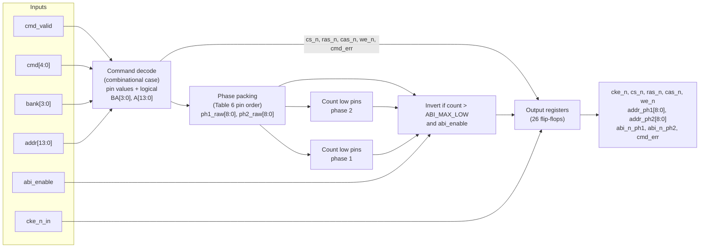

# `gddr5_cmd_enc` — Command and Address Encoder

Microarchitecture specification for `rtl/gddr5_cmd_enc.v` (with `rtl/gddr5_cmds.vh`).

| Field | Value |
|---|---|
| Module | `gddr5_cmd_enc` |
| Language | Verilog-2005 (`iverilog -g2005`, Verilator `--language 1364-2005`) |
| Clock domain | `clk` (the controller clock, CK) |
| Latency | 1 clock cycle (registered outputs) |
| Throughput | One command per clock |
| Reference standard | JEDEC JESD212C.01: Table 17 (§7.1), Table 6 (§4.1), §4.2 |
| Parent document | [`docs/microarchitecture.md`](../docs/microarchitecture.md), Section 6.7 |
| Status | Implemented and verified (see Section 10); LDFF not yet supported |

> Spec text is paraphrased, not copied. Section numbers refer to JESD212C.01 unless written "Section N", which refers to this document.

---

## 1. Purpose

The scheduler, initialization sequencer, refresh manager and training engine all issue commands as internal codes. A GDDR5 device does not see codes; it samples command pins on the rising edge of CK_t and an address bus on both the rising CK_t edge and the following rising CK_c edge. `gddr5_cmd_enc` converts one internal command per cycle into exactly the pin values the device expects, and optionally applies Address Bus Inversion (ABI) to reduce the number of address pins driven low.

It performs encoding only. It does not check whether a command is legal in the current bank state or timing window; that is the scheduler and timing tracker's job.

## 2. Block diagram



The module is a combinational front end (decode, pack, count, invert) followed by one rank of registers. There is no internal state beyond the output registers.

## 3. Parameters

| Parameter | Default | Meaning |
|---|---|---|
| `HAS_A12A13` | 1 | 1 if the shared A12/A13 address pin exists (2 Gb and larger devices); 0 for 512 Mb and 1 Gb. When 0, that pin is not counted by ABI. |
| `ABI_MAX_LOW` | 5 | Maximum number of address pins allowed low in one phase when ABI is on. 4 for 512 Mb and 1 Gb, 5 for 2 Gb and larger (§4.2). |

## 4. Interface

### 4.1 Inputs

| Signal | Width | Description |
|---|---|---|
| `clk` | 1 | Controller clock. |
| `rst_n` | 1 | Synchronous, active-low reset. |
| `cmd_valid` | 1 | 1: encode `cmd`. 0: drive DESELECT this cycle. |
| `cmd` | 5 | Internal command code, `GDDR5_CMD_*` from `gddr5_cmds.vh` (Section 5). |
| `bank` | 4 | Bank address (BA3..BA0). For MRS it is the mode-register number. Ignored by commands that do not use it. |
| `addr` | 14 | Meaning depends on the command: row address `A13..A0` (ACT); mode-register opcode in bits 11:0 (MRS); column address in bits 7:0 (READ/WRITE variants). Other bits are ignored. |
| `abi_enable` | 1 | 1: Address Bus Inversion in use. This is the logical "ABI is on" level; any inversion of the mode register bit's polarity is handled outside this module. |
| `cke_n_in` | 1 | Requested CKE_n level. Registered and passed through so the power manager can align it with a command. |

### 4.2 Outputs (all registered)

| Signal | Width | Description |
|---|---|---|
| `cke_n` | 1 | CKE_n, one cycle after `cke_n_in`. |
| `cs_n`, `ras_n`, `cas_n`, `we_n` | 1 each | Command pins, sampled by the device on rising CK_t. |
| `addr_ph1` | 9 | Address pins for the rising CK_t edge, MSB to LSB: `BA3 BA2 BA1 BA0 A12 A11 A10 A9 A8`. |
| `addr_ph2` | 9 | Address pins for the following rising CK_c edge, MSB to LSB: `A3 A4 A5 A2 A13 A6 A0 A1 A7`. |
| `abi_n_ph1`, `abi_n_ph2` | 1 each | ABI_n value for each phase (active low = the phase was inverted). |
| `cmd_err` | 1 | 1 when the command code was unsupported or undefined in the cycle that produced these outputs. |

Phase 2 is driven by the PHY half a CK cycle after phase 1. This module presents both phases in the same clock cycle; the PHY is responsible for the half-cycle placement and for launching phase 2 on CK_c.

### 4.3 Timing

| Cycle | Input | Output |
|---|---|---|
| N (setup before rising `clk`) | `cmd`, `bank`, `addr`, `abi_enable`, `cke_n_in` presented | — |
| N+1 (after the rising edge ending cycle N) | next command presented | encoded pins for the command from cycle N |

Latency is one cycle and throughput is one command per cycle. Back-to-back commands in consecutive cycles produce back-to-back pin patterns.

## 5. Internal command codes

Defined in `rtl/gddr5_cmds.vh`. These codes are internal to the controller; they are not device pin values.

| Code | Name | Meaning |
|---|---|---|
| 0 | `DES` | DESELECT |
| 1 | `NOP` | NO OPERATION |
| 2 | `MRS` | MODE REGISTER SET |
| 3 | `ACT` | ACTIVE |
| 4 | `RD` | READ |
| 5 | `RDA` | READ with auto-precharge |
| 6 | `WOM` | WRITE without mask |
| 7 | `WOMA` | WRITE without mask, auto-precharge |
| 8 | `WSM` | WRITE with single-byte mask |
| 9 | `WSMA` | WRITE with single-byte mask, auto-precharge |
| 10 | `WDM` | WRITE with double-byte mask |
| 11 | `WDMA` | WRITE with double-byte mask, auto-precharge |
| 12 | `RDTR` | READ training |
| 13 | `WRTR` | WRITE training |
| 14 | `PRE` | PRECHARGE, one bank |
| 15 | `PREALL` | PRECHARGE ALL |
| 16 | `REFPB` | PER-BANK REFRESH |
| 17 | `REF` | REFRESH, all banks |
| 18 | `SRE` | SELF REFRESH ENTRY |
| 19 | (reserved) | LDFF, not yet encoded |
| 20–31 | (undefined) | |

## 6. Functional description

### 6.1 Command decode

A combinational `case` on `cmd` (gated by `cmd_valid`) produces:
- the four command pin values,
- a logical bank address `ba_l[3:0]`,
- a logical address `a_l[13:0]`,
- an error flag.

Defaults before the `case` are DESELECT pins (`cs_n` high, the others high), `ba_l = 4'hF`, `a_l = 14'h3FFF` and no error. Every pin that Table 17 marks as "V" (any valid level) therefore ends up driven high. This choice keeps the count of low address pins small, which reduces how often ABI needs to invert.

### 6.2 Pin values per command

Pin values from Table 17 (§7.1). "V" pins are driven high.

| Command | CS_n | RAS_n | CAS_n | WE_n | A11 | A10 | A8 | Other logical bits |
|---|---|---|---|---|---|---|---|---|
| DES | H | H | H | H | H | H | H | all high |
| NOP | L | H | H | H | H | H | H | all high |
| MRS | L | L | L | L | op[11] | op[10] | op[8] | BA = register number; A11..A0 = `addr[11:0]`; A13, A12 = 0 |
| ACT | L | L | H | H | row[11] | row[10] | row[8] | BA = bank; A13..A0 = `addr[13:0]` |
| RD | L | H | L | H | L | L | L | BA = bank; A9 = H; A7..A0 = `addr[7:0]`; A12, A13 = H |
| RDA | L | H | L | H | L | L | **H** | as RD |
| WOM | L | H | L | L | L | L | L | as RD |
| WOMA | L | H | L | L | L | L | H | as RD |
| WSM | L | H | L | L | L | H | L | as RD |
| WSMA | L | H | L | L | L | H | H | as RD |
| WDM | L | H | L | L | H | L | L | as RD |
| WDMA | L | H | L | L | H | L | H | as RD |
| RDTR | L | H | L | H | H | H | L | BA and all other bits high |
| WRTR | L | H | L | L | H | H | L | BA and all other bits high |
| PRE | L | L | H | L | H | H | L | BA = bank; other bits high |
| PREALL | L | L | H | L | H | H | H | BA and other bits high |
| REFPB | L | L | L | H | H | H | L | BA = bank; other bits high |
| REF | L | L | L | H | H | H | H | BA and other bits high |
| SRE | L | L | L | H | H | H | H | as REF; CKE_n is raised by the power manager |

Notes:
- Auto-precharge is selected by A8 high (§7.14) and PRECHARGE ALL by A8 high (§7.13). REFRESH versus PER-BANK REFRESH is selected by A8 high or low (§7.15).
- READ and WRITE variants share CS_n/RAS_n/CAS_n; WE_n separates them. A11 and A10 select the mask type for writes and the training commands.
- For MRS the encoder forces A12 and A13 to 0 even if `addr[13:12]` is non-zero, because those pins are not defined for mode-register programming (§6).
- In READ/WRITE the column address uses `addr[7:0]` placed on A7..A0. A12 and A13 are driven high (don't care).

### 6.3 Phase packing (Table 6)

The device has nine physical address pins. Each carries two logical bits, one per phase:

| Pin position (MSB first) | 8 | 7 | 6 | 5 | 4 | 3 | 2 | 1 | 0 |
|---|---|---|---|---|---|---|---|---|---|
| Phase 1 (rising CK_t) | BA3 | BA2 | BA1 | BA0 | A12 | A11 | A10 | A9 | A8 |
| Phase 2 (rising CK_c) | A3 | A4 | A5 | A2 | A13 | A6 | A0 | A1 | A7 |

`ph1_raw` and `ph2_raw` are built from `ba_l` and `a_l` in exactly this order. Pin position 4 is the shared A12/A13 pin.

### 6.4 Address Bus Inversion (§4.2)

ABI reduces the number of address pins driven low, which reduces power and switching noise. For each phase independently:

1. Count the number of low pins in `ph_raw`, ignoring pin 4 when `HAS_A12A13 = 0`.
2. If `abi_enable` is set and the count is greater than `ABI_MAX_LOW`, drive the bitwise complement of `ph_raw` and set that phase's `abi_n` low.
3. Otherwise drive `ph_raw` unchanged with `abi_n` high.

After inversion a phase has at most 9 − 6 = 3 low pins when it was inverted, and at most `ABI_MAX_LOW` low pins when it was not. The device undoes the inversion based on ABI_n, so the logical address is unchanged. ABI applies to every address phase, including mode-register opcodes. With `abi_enable = 0`, `abi_n` is driven high and no inversion happens.

Worked examples (`ABI_MAX_LOW = 5`, `HAS_A12A13 = 1`):

| Command | ph_raw (phase 1) | Low pins | Result |
|---|---|---|---|
| ACT bank 0xA, row 0x2A5B | `101001010` | 5 | not inverted, `abi_n_ph1 = 1` |
| ACT bank 0xF, row 0 | `111100000` | 5 | not inverted, `abi_n_ph1 = 1` |
| ACT bank 0xE, row 0 | `111000000` | 6 | inverted to `000111111`, `abi_n_ph1 = 0` |
| ACT bank 0, row 0 | `000000000` | 9 | inverted to `111111111`, `abi_n_ph1 = 0` |

### 6.5 Output registers

All outputs are registered on the rising edge of `clk`. The register rank holds 26 flip-flops: 1 (`cke_n`) + 4 (command pins) + 9 + 9 (address phases) + 2 (`abi_n`) + 1 (`cmd_err`).

### 6.6 Reset

A synchronous, active-low reset (`rst_n` low at a rising edge) forces the outputs to a safe idle state: `cke_n` = 1, command pins high (DESELECT), both address phases all ones, both `abi_n` high, `cmd_err` low. Starting from reset, the first valid command appears one cycle after it is presented.

### 6.7 Error handling

Command codes 19 (reserved for LDFF) through 31 are not encoded. For these codes, with `cmd_valid` high, the encoder drives DESELECT pins and an all-ones address (no inversion needed) and sets `cmd_err` for that cycle. `cmd_err` is not sticky; it follows the code presented. The scheduler must never issue these codes; a testbench or assertion should flag `cmd_err`.

## 7. Integration notes

- **Power manager.** `cke_n_in` is registered and appears with the command it accompanies. For SELF REFRESH ENTRY, drive `cmd = SRE` and `cke_n_in = 1` in the same cycle. For POWER-DOWN entry and exit, drive `cmd = NOP` or `DES` with the appropriate CKE_n change (Table 17, Table 32).
- **PHY.** The PHY samples `addr_ph1` with the command pins and launches `addr_ph2` on the following CK_c edge. The PHY must also drive the ABI_n pin twice per command (once per phase).
- **ABI mode bit.** `abi_enable` is the logical "ABI on" signal. The MR1 bit's polarity (0 = enabled in the standard's figure) must be translated by the CSR or init logic before it reaches this port.
- **Reset values.** After reset the device's own ABI state is defined by the standard (ABI_n has a defined default). Keep `abi_enable` low until the mode register is programmed, unless the controller knows the device default.
- **Unused input bits.** `addr[13:12]` are ignored for MRS; `addr[13:8]` are ignored for READ/WRITE variants (A8 is controlled by the command code; A9–A13 are driven high).

## 8. Assumptions and open items

| # | Item |
|---|---|
| O1 | **LDFF** is not encoded. Table 17 note 7 puts its data bits on A0–A9 and BA3, but A8 and A10 are also fixed qualifier pins for that command. The placement of the data bits needs a closer reading of the standard before encoding. Code 19 is reserved for it. |
| O2 | The mapping of A12/A13 on 2 Gb versus 4/8 Gb devices (A13 exists only on 4 Gb and 8 Gb) is treated as one shared physical pin that is present or absent. ACT row bits A12 and A13 share it across the two phases per Table 6. |
| O3 | The documented ABI limit (4 or 5 low pins) is applied per phase. The standard's flow diagram describes the count over the address lines of one transfer. Per-phase counting is the straightforward reading but should be re-checked against the device timing notes. |
| O4 | Values the standard marks "V" are driven high. Any value is allowed, so this is a design choice, made to reduce inversions and power. |

## 9. Resource and timing expectations

- 26 flip-flops. The combinational logic is a 19-way decode, a nine-bit pin packing (wiring only), two nine-input low-pin counters and two nine-bit conditional inverters.
- The critical path runs from `cmd`/`bank`/`addr` through decode and the low-pin counter and comparator to the inversion mux and the output registers. It is a short path for a modern process, so the encoder is not expected to limit the controller clock. No synthesis result has been produced yet; the first measurement will come with the Yosys flow in phase 5.

## 10. Verification

| Test | Location | What it covers |
|---|---|---|
| Directed testbench | `tb/tb_gddr5_cmd_enc.v` | 31 checks with hand-derived expected values: every supported command, ABI boundary (5 low pins not inverted, 6 inverted), idle cycles, undefined codes, reset, CKE_n pass-through |
| cocotb random test | `tests_cocotb/test_cmd_enc.py` | 760 random vectors across all commands with ABI on and off, against an independent table-driven Python model; plus invalid-cycle, undefined-code and ABI-limit tests |
| Lint | `make lint` | Verilator `-Wall` on 1364-2005, clean |

Mutation checks: eight deliberately injected RTL bugs (swapped address pins, ABI off by one, flipped auto-precharge polarity, wrong A10, wrong WE_n, MRS passing A12/A13, a wrong ABI limit, a wrong refresh A8) were all detected by the tests.

Both reference models were written from the same tables as the RTL. They are independent of the RTL's code, but a shared misreading of a table would not be caught. Spot-check against Table 17 in the standard when reviewing.

Run locally:

```
make lint      # Verilator lint
make sim       # Verilog directed testbench (Icarus, -g2005)
make cocotb    # cocotb tests (Icarus)
make all
```

## 11. Spec traceability

| Spec item | Where it is implemented |
|---|---|
| Table 17: command pin values and qualifiers | Command decode `case` (Section 6.1, 6.2) |
| Table 6: address pin pairs per phase | Phase packing (Section 6.3) |
| §4.2: Address Bus Inversion | `count_low`, `inv1`, `inv2` and the output mux (Section 6.4) |
| §7.14: auto-precharge on A8 high | RDA, WOMA, WSMA, WDMA (Section 6.2) |
| §7.13: PRECHARGE ALL on A8 high | `PREALL` (Section 6.2) |
| §7.15: REFRESH vs PER-BANK REFRESH on A8 | `REF`, `REFPB` (Section 6.2) |
| §7.4, §6: MRS, A12/A13 unused | `MRS` (Section 6.2) |

## 12. Revision history

| Rev | Date | Change |
|---|---|---|
| 1.0 | 2026-11-19 | Initial module specification for the implemented encoder |
