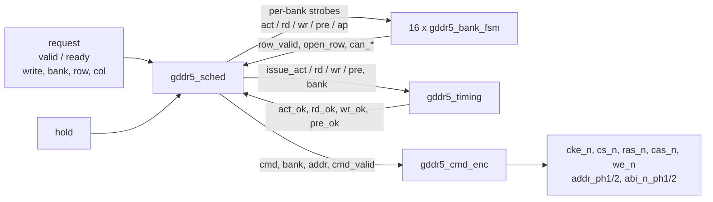

# `gddr5_ctrl_core` — Request-to-Pins Command Path

Microarchitecture specification for `rtl/gddr5_ctrl_core.v`.

| Field | Value |
|---|---|
| Module | `gddr5_ctrl_core` |
| Language | Verilog-2005 (`iverilog -g2005`, Verilator `--language 1364-2005`) |
| Clock domain | `clk` (the controller clock, CK) |
| Latency | Command pins appear one cycle after the command is issued (`cmd_valid`) |
| Reference standard | JEDEC JESD212C.01: command truth table, Table 9 spacings, bank states |
| Parent document | [`docs/microarchitecture.md`](../docs/microarchitecture.md), Section 6.5 |
| Status | Implemented and verified (see Section 7); refresh, init, training and data paths are not part of it yet |

> Spec text is paraphrased, not copied. Timing values are module parameters with illustrative defaults, because the AC table of the standard is vendor-defined.

---

## 1. Purpose

`gddr5_ctrl_core` is the first integrated slice of the controller. It takes one decoded request (read or write, bank, row, column) and turns it into the stream of device commands that serves it, already encoded for the command and address pins. It contains no logic of its own beyond wiring. All behaviour comes from the four modules it instantiates.

## 2. Block diagram



## 3. Interface

| Group | Signals |
|---|---|
| Clock and reset | `clk`, `rst_n` (active-low, synchronous) |
| Request in | `req_valid`, `req_ready`, `req_write`, `req_bank[3:0]`, `req_row[13:0]`, `req_col[6:0]` |
| Bus ownership | `hold`: another sequencer owns the command bus; nothing issues while it is high |
| Encoder controls | `abi_enable`, `cke_n_in` |
| Device pins | `cke_n`, `cs_n`, `ras_n`, `cas_n`, `we_n`, `addr_ph1[8:0]`, `addr_ph2[8:0]`, `abi_n_ph1`, `abi_n_ph2` |
| Observation | `cmd_valid`, `cmd[4:0]`, `cmd_bank[3:0]`, `cmd_addr[13:0]`: the command issued this cycle, before encoding |
| Status | `busy`, `req_done`, `bank_idle[15:0]`, `err_bank`, `err_timing`, `err_enc` |

A request is accepted in a cycle where `req_valid` and `req_ready` are both high. `req_ready` is high when no request is held, and in the cycle the held request issues its column command, so back-to-back requests do not lose a cycle.

## 4. Parameters

All parameters are forwarded unchanged to the submodule that uses them. Values are clock cycles.

| Group | Parameters | Module |
|---|---|---|
| Policy | `AUTO_PRECHARGE` | `gddr5_sched` |
| Per bank | `TRCDRD`, `TRCDWR`, `TRAS`, `TRC`, `TRP`, `TRTP`, `TW2PRE`, `TRFCPB` | `gddr5_bank_fsm` |
| Cross bank | `BG_ENABLE`, `GROUP_LSB`, `TRRDS`, `TRRDL`, `TFAW`, `T32AW`, `TCCDS`, `TCCDL`, `TW2RS`, `TW2RL`, `TRTW`, `TPPD` | `gddr5_timing` |
| Encoder | `HAS_A12A13`, `ABI_MAX_LOW` | `gddr5_cmd_enc` |

Each parameter is documented in the README of its module.

## 5. Behaviour

Event-driven description, using the module's own signal names.

```
on req_valid && req_ready:
    the scheduler holds the request (write, bank, row, col)

each cycle with a held request and !hold:
    if the bank has an open row equal to req_row           # row hit
        wait until bank_can_rd/wr[bank] && t_rd_ok/t_wr_ok[bank]
        issue RD or WOM (RDA or WOMA when AUTO_PRECHARGE)
        req_done = 1
    else if the bank has an open row that differs          # row miss
        wait until bank_can_pre[bank] && t_pre_ok
        issue PRE
    else                                                   # bank closed
        wait until bank_can_act[bank] && t_act_ok[bank]
        issue ACT with cmd_addr = req_row

on a command issued (cmd_valid):
    strobe the matching bank_act/rd/wr/pre[bank] into gddr5_bank_fsm
    strobe the matching t_issue_* into gddr5_timing
    present cmd, cmd_bank, cmd_addr to gddr5_cmd_enc

one cycle later:
    cs_n, ras_n, cas_n, we_n, addr_ph1/2, abi_n_ph1/2 show the encoded command
    (DES pins when no command was issued)

on hold:
    cmd_valid stays low; the held request waits
```

Address on the observation port: ACT carries the row, column commands carry `{7'd0, col}`, PRE carries 0.

With `AUTO_PRECHARGE=0` the policy is open page: a row stays open until a request to a different row in the same bank forces a PRE. With `AUTO_PRECHARGE=1` every column command closes the row, so every request is ACT then column.

A command issues only when both the bank's own flag and the cross-bank flag are high. Because the scheduler is in order and works on one request at a time, tFAW and t32AW bind only when the per-bank spacings are short.

## 6. Error flags

| Flag | Meaning |
|---|---|
| `err_bank` | OR of the 16 `cmd_err` outputs: a strobe arrived that the bank state did not allow |
| `err_timing` | The timing tracker saw an illegal strobe |
| `err_enc` | The encoder saw an undefined command code |

All three should stay low. They exist to catch integration mistakes; the scheduler never issues an illegal command by construction.

## 7. Verification

`tests_cocotb/test_ctrl_core.py` checks every cycle of every test three ways:

1. **Policy:** the issued command sequence equals the one predicted by an independent open-row tracker.
2. **Legality:** every command is legal for the bank reference model and the cross-bank reference model, both written with absolute cycle numbers.
3. **Pins:** the encoder outputs one cycle later equal the encoder reference model, with `abi_enable` random.

It also checks that no error flag rises, that `hold` silences the bus, that every accepted request completes, and that a reset in the middle of traffic returns the controller to idle.

Tests: single read and write, row-hit stream, row-conflict stream, bank spread, random mixed with hold bursts, random sparse, reset.

Parameter sets (run from `make cocotb`): default, auto-precharge, small timings, small timings with auto-precharge, tight tFAW, tight t32AW. The last two exist because the activate windows do not bind in an in-order stream at the other settings; a mutation that left tFAW or t32AW unforwarded survived until they were added. All 13 wiring mutations tried on the core are now caught.

## 8. Open items

| # | Item | Plan |
|---|---|---|
| O1 | No request queue or address map: the caller supplies bank, row and column | Next PRs |
| O2 | Per-bank refresh strobes are tied low; all-bank REF, PREALL and MRS are not issued | Refresh and init modules |
| O3 | In-order scheduling only | Row-hit-first reordering over a queue |
| O4 | No data path, write data or read capture | Data-path modules |
