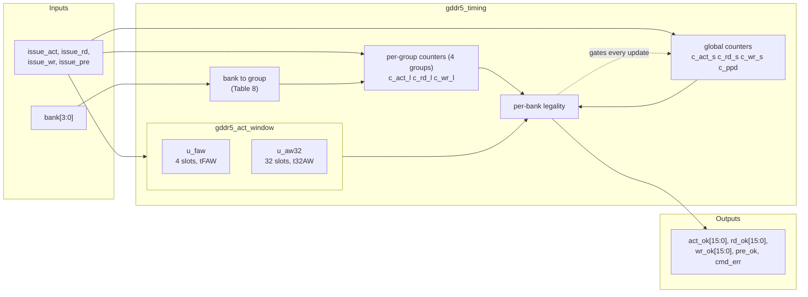

# `gddr5_timing` — Cross-Bank Timing Tracker

Microarchitecture specification for `rtl/gddr5_timing.v` and its helper `rtl/gddr5_act_window.v`.

| Field | Value |
|---|---|
| Modules | `gddr5_timing`, `gddr5_act_window` |
| Language | Verilog-2005 (`iverilog -g2005`, Verilator `--language 1364-2005`) |
| Clock domain | `clk` (the controller clock, CK) |
| Instances | One per device (all banks share it) |
| Latency | Outputs reflect a command in the cycle after it is issued |
| Reference standard | JEDEC JESD212C.01: Table 8 (bank groups), Table 9, tFAW and t32AW (Figures 45 and 46), Table 35 |
| Parent document | [`docs/microarchitecture.md`](../docs/microarchitecture.md), Section 6.4 |
| Status | Implemented and verified (see Section 10); training-command spacing and refresh interactions are open (Section 8) |

> Spec text is paraphrased, not copied. Section numbers refer to JESD212C.01 unless written "Section N", which refers to this document.

---

## 1. Purpose

Some spacing rules involve two different banks, or the whole device: how soon after an ACTIVE another bank may activate, how closely column accesses may follow each other on the shared data bus, and how many activates fit in a rolling window. `gddr5_timing` tracks those rules and tells the scheduler, for every bank, whether an ACT, READ or WRITE is allowed this cycle, and whether a PRECHARGE is allowed.

Spacings that involve only one bank (tRC, tRCD, tRAS, tRP, tRTP, write recovery, refresh) live in `gddr5_bank_fsm`. A command is legal only when both modules allow it. This module does not check bank state, and it does not issue commands.

## 2. Block diagram



## 3. Parameters

All timings are minimum command-to-command spacings in clock cycles, converted by the caller with `ceil(T_ps / TCK_PS)`. The defaults are illustrative placeholders, not vendor data: Table 54 of the standard leaves AC values to the device datasheet. A value of 0 or 1 both mean "legal in the next cycle".

| Parameter | Default | Meaning |
|---|---|---|
| `BG_ENABLE` | 1 | 1: bank groups on (MR3 A11 = 1), the "L" spacings apply within a group. 0: the "S" spacings apply to every pair of banks. |
| `GROUP_LSB` | 2 | Position of the group bits in the bank address: 2 for 16 banks (`bank[3:2]`), 1 for 8 banks (`bank[2:1]`) |
| `TRRDS` | 5 | ACT to ACT, different group (or groups off) |
| `TRRDL` | 7 | ACT to ACT, same group |
| `TFAW` | 23 | Rolling window that may hold at most 4 ACTs |
| `T32AW` | 184 | Rolling window that may hold at most 32 ACTs |
| `TCCDS` | 2 | READ to READ and WRITE to WRITE, different group (or groups off) |
| `TCCDL` | 4 | READ to READ and WRITE to WRITE, same group (3 or 4 per MR3) |
| `TW2RS` | 12 | WRITE to READ, different group. The caller supplies WL + burst time + tWTRS. |
| `TW2RL` | 14 | WRITE to READ, same group. The caller supplies WL + burst time + tWTRL. |
| `TRTW` | 14 | READ to WRITE bus turnaround, any group |
| `TPPD` | 2 | PRE to PRE, any banks |

Limits: `TFAW` and every other spacing must be below 256 (`CW = 8`). `T32AW` must be below 1024 (the 32-slot window uses 10-bit counters). The standard asks for `T32AW >= 8 * TFAW`; if they are equal, t32AW can never be the binding limit.

## 4. Interface

### 4.1 Inputs

| Signal | Width | Description |
|---|---|---|
| `clk` | 1 | Controller clock |
| `rst_n` | 1 | Synchronous active-low reset |
| `issue_act` | 1 | An ACTIVE is issued to `bank` this cycle |
| `issue_rd` | 1 | A READ is issued to `bank` |
| `issue_wr` | 1 | A WRITE is issued to `bank` |
| `issue_pre` | 1 | A PRECHARGE is issued (`bank` is not used) |
| `bank` | 4 | Target bank of the strobed command |

At most one strobe may be high in a cycle. Strobes must be pulses that follow the legality outputs; an illegal strobe is ignored.

### 4.2 Outputs

| Signal | Width | Description |
|---|---|---|
| `act_ok` | 16 | Bit `b`: an ACT to bank `b` is legal this cycle |
| `rd_ok` | 16 | Bit `b`: a READ to bank `b` is legal this cycle |
| `wr_ok` | 16 | Bit `b`: a WRITE to bank `b` is legal this cycle |
| `pre_ok` | 1 | A PRECHARGE is legal this cycle (tPPD) |
| `cmd_err` | 1 | Registered. High for one cycle after an illegal strobe. |

The legality vectors depend only on registers, so they are stable early in the cycle and do not depend on the strobe inputs. For a device with 8 banks, bits 15:8 are unused by the scheduler.

### 4.3 Timing

A command in cycle `t` updates the counters at the end of cycle `t`. In cycle `t + N`, a spacing of `N` cycles has elapsed and the dependent legality bit is high. A spacing of 1 or less means the very next cycle.

## 5. Bank groups

Table 8 divides the banks into four groups. For a device with 16 banks the groups are banks 0–3 (A), 4–7 (B), 8–11 (C) and 12–15 (D), so the group is `bank[3:2]`. For 8 banks (512 Mb) the groups are 0–1, 2–3, 4–5 and 6–7, so the group is `bank[2:1]`. `GROUP_LSB` selects between the two.

Which spacing applies follows Table 9:

| Sequence | Different group, or `BG_ENABLE = 0` | Same group (`BG_ENABLE = 1`) |
|---|---|---|
| ACT to ACT | `TRRDS` | `TRRDL` |
| READ to READ | `TCCDS` | `TCCDL` |
| WRITE to WRITE | `TCCDS` | `TCCDL` |
| WRITE to READ | `TW2RS` | `TW2RL` |
| READ to WRITE | `TRTW` | `TRTW` |

## 6. Functional description

### 6.1 Counters

| Counter | Scope | Loaded by | Blocks |
|---|---|---|---|
| `c_act_s` | Global | ACT (`TRRDS`) | ACT to every bank |
| `c_act_l[g]` | Group `g` | ACT in group `g` (`TRRDL`) | ACT to group `g` |
| `c_rd_s` | Global | RD (`TCCDS`), WR (`TW2RS`) | READ to every bank |
| `c_rd_l[g]` | Group `g` | RD in `g` (`TCCDL`), WR in `g` (`TW2RL`) | READ to group `g` |
| `c_wr_s` | Global | WR (`TCCDS`), RD (`TRTW`) | WRITE to every bank |
| `c_wr_l[g]` | Group `g` | WR in `g` (`TCCDL`) | WRITE to group `g` |
| `c_ppd` | Global | PRE (`TPPD`) | PRE |

Each is a down-counter. A command that imposes a spacing `N` loads `N - 1`, so the counter reads 0 in cycle `t + N`. When a counter may already hold a longer wait than the new load, it keeps the larger value (`keep_max`). With the usual ordering of the parameters this never matters, but it protects against parameter sets where a later command has a shorter spacing than the wait still running.

The "S" counters are global, so they also delay a bank in the same group. This is correct because the "L" spacing is always at least the "S" spacing in the standard.

### 6.2 Activate windows

`gddr5_act_window` limits the number of ACTs in a rolling window. It has `SLOTS` down-counters. An ACT loads the lowest free slot with `WIN - 1`; the slot is free again `WIN` cycles after the ACT. The window is `full` when no slot is free, and an ACT is then not allowed. A 5th ACT is therefore legal exactly `TFAW` cycles after the first of the four before it. `gddr5_timing` instantiates it twice: 4 slots with `TFAW`, and 32 slots with `T32AW`.

A push while the window is full is ignored by the window and is also blocked by `gddr5_timing`, which pushes only for legal ACTs.

### 6.3 Legality

```
for bank b in group g:
    act_ok[b] = c_act_s == 0
                and (BG_ENABLE == 0 or c_act_l[g] == 0)
                and not faw_full and not aw32_full
    rd_ok[b]  = c_rd_s == 0 and (BG_ENABLE == 0 or c_rd_l[g] == 0)
    wr_ok[b]  = c_wr_s == 0 and (BG_ENABLE == 0 or c_wr_l[g] == 0)
pre_ok = c_ppd == 0
```

### 6.4 Behavior (event-driven)

```
every cycle:
    each counter != 0: counter <= counter - 1
    cmd_err <= (issue_act and not act_ok[bank])
            or (issue_rd  and not rd_ok[bank])
            or (issue_wr  and not wr_ok[bank])
            or (issue_pre and not pre_ok)

on issue_act with act_ok[bank]:
    c_act_s <= TRRDS - 1
    c_act_l[grp] <= TRRDL - 1
    u_faw.push, u_aw32.push

on issue_rd with rd_ok[bank]:
    c_rd_s      <= max(c_rd_s - 1,      TCCDS - 1)
    c_rd_l[grp] <= max(c_rd_l[grp] - 1, TCCDL - 1)
    c_wr_s      <= max(c_wr_s - 1,      TRTW - 1)

on issue_wr with wr_ok[bank]:
    c_wr_s      <= max(c_wr_s - 1,      TCCDS - 1)
    c_wr_l[grp] <= max(c_wr_l[grp] - 1, TCCDL - 1)
    c_rd_s      <= max(c_rd_s - 1,      TW2RS - 1)
    c_rd_l[grp] <= max(c_rd_l[grp] - 1, TW2RL - 1)

on issue_pre with pre_ok:
    c_ppd <= TPPD - 1
```

An illegal strobe changes nothing except `cmd_err`. In particular it does not take a slot in either activate window.

### 6.5 Worked example

Timings: tRRDS=2, tRRDL=3, tFAW=10, tCCDS=2, tCCDL=4, tW2RS=6, tW2RL=8, tRTW=5. Banks 0–3 are group A, 4–7 are group B.

| Sequence | Observation |
|---|---|
| ACT bank 0 in cycle 0 | `act_ok[4]` (group B) rises in cycle 2; `act_ok[1]` (group A) in cycle 3 |
| ACTs at 0, 2, 4, 6 to four different groups | Fifth ACT legal in cycle 10 (tFAW from the first), even though tRRD was met at cycle 8 |
| RD bank 0 in cycle 0 | `rd_ok[4]` in cycle 2, `rd_ok[1]` in cycle 4 |
| WR bank 0 in cycle 0 | `rd_ok[4]` in cycle 6, `rd_ok[1]` in cycle 8 |
| RD bank 0 in cycle 0 | `wr_ok` for any bank in cycle 5 |

### 6.6 Reset

Synchronous. All counters and both windows clear, so every legality bit is high in the first cycle after reset release.

### 6.7 Error handling

`cmd_err` is a one-cycle flag in the cycle after an illegal strobe, meant to catch scheduler bugs in simulation and to raise a sticky CSR status bit. Behavior with two strobes in one cycle is not defined; the scheduler issues one command per cycle.

## 7. Integration notes

- **Selection.** The scheduler issues a command to bank `b` only when the bank's `can_*` from `gddr5_bank_fsm` and the matching `*_ok[b]` from this module are both high, then pulses the strobe at both and the command code at `gddr5_cmd_enc`.
- **Parameters from the parent.** `TW2RS`/`TW2RL` are WL + burst time + tWTRS/tWTRL. `TCCDL` follows MR3 A10 (3 or 4). `BG_ENABLE` follows MR3 A11. The parent also converts READ-to-PRECHARGE (tRTPL or tRTPS) into the `TRTP` parameter of `gddr5_bank_fsm`; that spacing is not handled here.
- **Cost.** Most of the area is the 32-slot window (32 ten-bit counters). If area becomes important, a timestamp ring can replace it without changing the interface.

## 8. Assumptions and open items

| # | Item |
|---|---|
| O1 | **Table 8 reading.** The bank-to-group mapping was read from the extracted text of Table 8, which was jumbled. The 16-bank grouping (0–3, 4–7, 8–11, 12–15) should be confirmed against the standard's page. |
| O2 | **Training commands.** RDTR and WRTR use tCCDS even with bank groups enabled (notes in the training sections). They are not issued through this module yet. |
| O3 | **Refresh.** REFPB and all-bank REF are not counted against tRRD or the activate windows. The effect of refresh on those spacings has not been checked against the standard. |
| O4 | **PREALL.** One PRECHARGE ALL counts as a single PRE for tPPD. Whether the standard requires different spacing after PREALL is not checked. |
| O5 | **LP1 and low-frequency modes.** tFAW and t32AW may have a second value in LP1 mode (see the standard). The parent would have to change the parameters; the module has no run-time switch. |
| O6 | **Parameter ordering.** The model assumes the "L" spacing is at least the "S" spacing. Values that violate this are outside the standard. |
| O7 | Default values are placeholders. A real speed bin comes from a datasheet or an explicit project choice. |

## 9. Resource and timing expectations

Measured with Yosys `synth -flatten` on the default parameters (generic gates, no technology mapping):

- About 480 flip-flops: 320 for the 32-slot window, 32 for the 4-slot window, 96 for the twelve per-group counters, 32 for the four global counters, and one for `cmd_err`.
- About 3,300 generic cells in total.

No timing result exists yet. Each legality bit is a small AND of zero-detects and the two window `full` flags. The 32-slot `full` and free-slot search is the longest path; it is not expected to limit the clock. The first measurement will come with the OpenSTA flow in phase 5.

## 10. Verification

| Test | Where | What it covers |
|---|---|---|
| Directed, window | `tb/tb_gddr5_act_window.v` | 11 checks: slot allocation, release order, a push while full is ignored, reset |
| Directed, timing | `tb/tb_gddr5_timing.v` | 45 checks with hand-derived cycle numbers: tRRDS/tRRDL, tFAW and t32AW at the exact boundary cycle, tCCD, write-to-read, read-to-write, tPPD, bank groups on and off, illegal strobes (including one in the middle of the 32-ACT run), reset |
| cocotb, mixed traffic | `tests_cocotb/test_timing.py` | Random legal ACT, READ, WRITE and PRE traffic |
| cocotb, activate storm | same | Back-to-back ACTs that drive tFAW and, when `T32AW > 8 * TFAW`, t32AW to their limits, with coverage checks |
| cocotb, illegal strobes | same | 30 to 35 % illegal strobes must be ignored and flagged |
| cocotb, random reset | same | Reset at random points clears all history |
| Timing variants | `Makefile` | The cocotb tests run with the default values, a small set where t32AW can bind, bank groups off, 8-bank grouping, and an odd set where write-to-read is shorter than tCCDL |

The cocotb reference model keeps a history of recent commands and checks each pair against the spacing rules (`now >= t_earlier + spacing`). The RTL uses counters and slot arrays instead. Every cycle the model's 48 per-bank bits, `pre_ok` and `cmd_err` are compared with the RTL.

**Mutation testing.** Faults were injected into both modules: wrong or missing loads for each spacing, off-by-one windows, the window ignoring a slot, a window push by an illegal ACT, wrong group mapping, ignored bank-group disable, the keep-the-larger rule replaced by a plain load. Some survived the first pass and led to additions: the illegal-ACT test, the standalone window testbench, and the odd timing set. After those, every fault that changes behavior was caught.

Not yet covered: formal properties (planned in phase 5) and a check against a DRAM model (planned with the behavioral PHY).

## 11. Spec traceability

| Requirement (JESD212C.01) | Where it is implemented |
|---|---|
| Bank-to-group assignment (Table 8) | `grp`, `G` in `gddr5_timing` (open item O1) |
| ACT to ACT: tRRDS, tRRDL (Table 9) | `c_act_s`, `c_act_l` |
| READ to READ, WRITE to WRITE: tCCDS, tCCDL (Table 9) | `c_rd_s/l`, `c_wr_s/l` |
| Internal WRITE to READ: tWTRS, tWTRL (Table 9, Table 35) | `TW2RS`, `TW2RL` into `c_rd_s/l` |
| READ to WRITE turnaround | `TRTW` into `c_wr_s` |
| No more than 4 ACTs in tFAW (Figure 45) | `u_faw` |
| No more than 32 ACTs in t32AW (Figure 46) | `u_aw32` |
| PRE to PRE: tPPD | `c_ppd` |
| READ to PRECHARGE: tRTPS, tRTPL (Table 9 note 1) | Not here; `TRTP` in `gddr5_bank_fsm` |

## 12. Revision history

| Rev | Date | Change |
|---|---|---|
| 1.0 | 2026-11-27 | First version, written from the implemented RTL |
